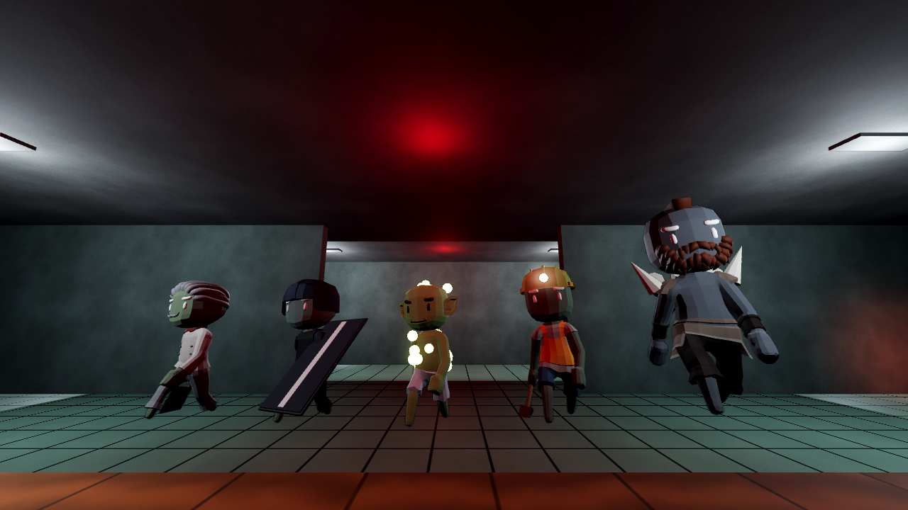
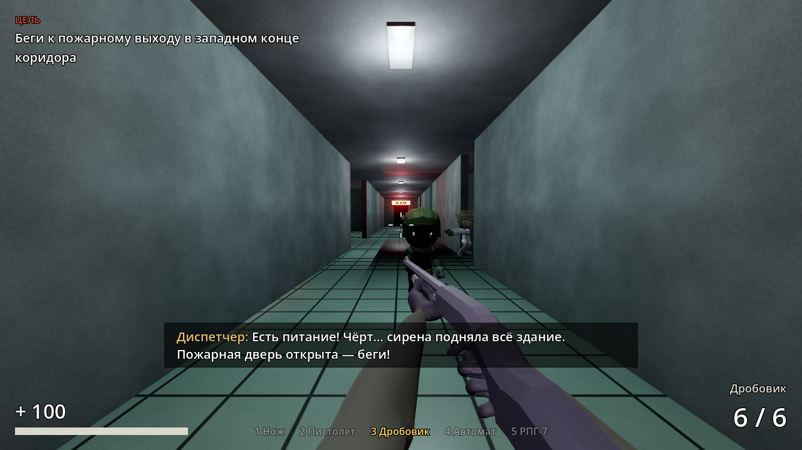
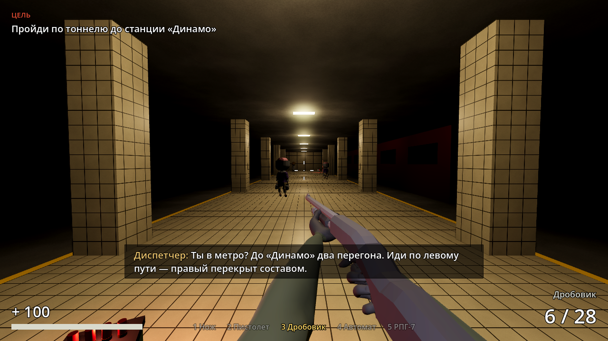
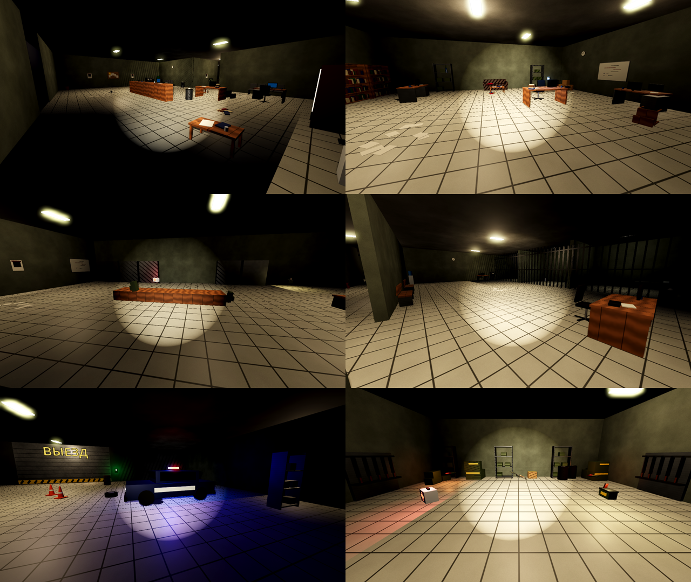
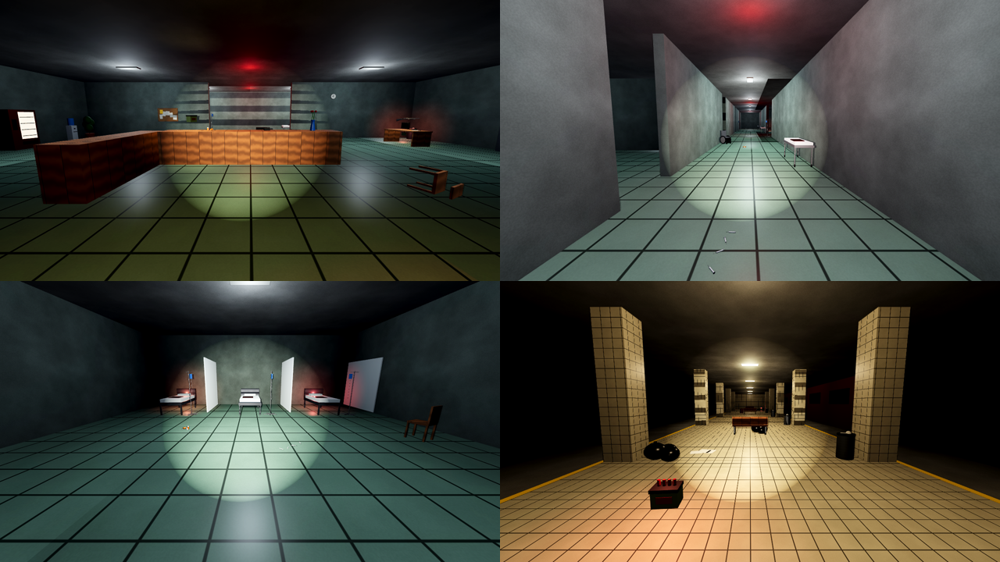

# Мёртвый город

Сюжетный шутер от первого лица про зомби на Godot 4.7. Пять глав, пять боссов, пять видов оружия,
одна цель — успеть на последний вертолёт.

| | |
|---|---|
|  |  |
|  |  |
|  |  |

Обстановка: в участке кабинеты с книжными шкафами и рабочими местами, камеры с нарами, гараж с верстаком
и шинами, оружейная со стойками; в больнице капельницы, тележки со шприцами и каталки; в метро вещи беженцев.

| | |
|---|---|
|  |  |

*Скриншоты сняты в облаке на программном рендере (упрощённая графика). В редакторе Godot с Forward+
будут мягкие тени, SSAO и свечение.*

## Как запустить

1. Нужен Godot **4.7** (обычная версия, не .NET) — https://godotengine.org/download
2. В менеджере проектов: **Импорт** → выберите `dead-city/project.godot`.
3. Нажмите **F5**. Игра начинается с главного меню.

Чтобы сразу попасть в нужную главу, откройте её сцену в `scenes/levels/` и нажмите **F6**
(«Запустить текущую сцену»).

## Управление

| Клавиша | Действие |
|---|---|
| W A S D | движение |
| Shift | бег |
| Пробел | прыжок |
| ЛКМ | атака / выстрел |
| R | перезарядка |
| 1 2 3 4 5, колесо мыши | нож, пистолет, дробовик, автомат, РПГ-7 |
| E | использовать (двери, ворота) |
| F | фонарик |
| Esc / P | пауза |

## Сюжет

Девять дней назад мёртвые поднялись. Старая рация ловит голос диспетчера: на рассвете со стадиона
улетает эвакуационный вертолёт.

1. **Окраина.** Ночная улица, горящие машины, брошенный автобус. Доберитесь до полицейского участка —
   по пути найдётся автомат, но выстрелы привлекут толпу из переулков. Вход в участок сторожит **Мясник**.
2. **Участок.** Тёмное здание (включите фонарик). Найдите ключ-карту, откройте оружейную и заберите РПГ-7.
   Сработает тревога: откроются камеры с заключёнными. Во дворе, у машины, ждёт **Надзиратель**.
3. **Больница.** Мост к стадиону забит — путь лежит через больницу к метро. Света нет, пожарный выход
   на электрозамке: найдите дробовик на посту охраны, запустите генератор в техническом крыле — и бегите,
   когда сирена поднимет все палаты. Во дворе у входа в метро — **Пациент Ноль**.
4. **Метро.** Платформа, тёмный тоннель и сошедший с рельсов вагон, который придётся обойти служебным
   коридором. Сзади настигают бегуны, а на станции «Динамо» выход закрыт решёткой — держитесь минуту,
   пока диспетчер её взламывает. Из бокового прохода выходит **Обходчик**.
5. **Стадион.** Доберитесь до вертолётной площадки и продержитесь две минуты, пока пилот не сможет сесть.
   На середине осады с севера приходит **Колосс** — пока он жив, вертолёт не сядет.

Прогресс сохраняется в начале каждой главы — в главном меню появится «Продолжить».

## Враги

| | Здоровье | Особенности |
|---|---|---|
| **Ходок** | 120 | медленно бредёт, вытянув руки; бродит, пока не заметит или не услышит вас |
| **Бегун** | 90 | бежит со всех ног, видит дальше |
| **Громила** | 1200 | огромный, почти не вздрагивает от попаданий, отбрасывает ударом |

Обычного зомби больше не убить одним выстрелом: ходку нужно два попадания в голову из пистолета
или автомата (или четыре в тело), бегуну — два в голову. Дробовик вплотную по-прежнему кладёт с одного выстрела.

## Боссы

В конце каждой главы — свой босс. Над экраном появляется полоска его здоровья, начинает играть
боевая музыка (метал, оркестр, а для Колосса — эпический финальный трек), а выход открывается,
только когда он погибнет. Боссы не сбегаются на шум: они ждут вас на своей арене.

| | Глава | Здоровье | Как воюет | Как победить |
|---|---|---|---|---|
| **Мясник** | Окраина | 1100 | повар с тесаком: рубит и бросается в рывок с разбега | уйдите в сторону; врезавшись в стену, он теряет равновесие |
| **Надзиратель** | Участок | 1300 | полицейский со щитом и дубинкой; щит гасит 90% урона спереди | стреляйте в голову, заходите сбоку или бейте из РПГ |
| **Пациент Ноль** | Больница | 1200 | плюётся кислотой (три плевка веером) и созывает больных | держите дистанцию, не стойте на месте, сначала добивайте свиту |
| **Обходчик** | Метро | 1600 | путеец с кувалдой: удар о землю бьёт волной на 7 м, зовёт бегунов из тоннеля | прыгните в момент удара — волна идёт по полу |
| **Колосс** | Стадион | 4000 | великан: швыряет обломки, бьёт о землю, таранит; на половине здоровья впадает в ярость | РПГ и автомат, не стойте в линию рывка |

Модели боссов собраны в Blender из персонажей того же CC0-пака, а оружие и мутации
(тесак, щит, кувалда, светящиеся наросты, костяные шипы) смоделированы скриптом и прикреплены к костям.

Зомби — анимированные 3D-модели со скелетом (ходьба, бег, удар, реакция на попадание, смерть).
Каждый раз выбирается случайное тело: настоящие зомби или заражённые рабочие, врачи, повара и солдаты,
с перекрашенной мёртвой кожей. Голоса — настоящие записи: стоны, рык при атаке, хрип при смерти;
стоны звучат реже и никогда не хором.

Зомби слышат выстрелы (у каждого оружия свой радиус шума) и зовут соседей. **Нож бесшумный.**
Попадание в голову наносит повышенный урон, а убийство в голову её сносит.

## Оружие

| | Урон | Особенности |
|---|---|---|
| **Нож** | 50 | бесконечный, бесшумный, удары слева-направо |
| **Пистолет** | 34 (×2.5 в голову) | точный, одиночные выстрелы |
| **Дробовик** | 8 × 20 | помповый: 8 дробин, вплотную разрывает, издалека слабый; заряжается по одному патрону (выстрелом можно прервать) |
| **Автомат** | 30 (×2.5 в голову) | автоматический огонь, разброс растёт в очереди и на бегу |
| **РПГ-7** | 220 по площади | выстрел с дымным следом, взрыв задевает и вас, если стоять близко |

Оружие и руки в перчатках — 3D-модели: руки сжимают рукояти, у РПГ виден заряженный выстрел.

## Как устроены уровни (для редактирования)

Сюжет собран из узлов в ветке `Story` каждого уровня — их можно менять прямо в инспекторе:

- **StoryEvent** — одно событие сюжета: новая цель, сообщение по рации и список узлов в `targets`,
  которые нужно «активировать» (открыть дверь, запустить спаунер, разбудить зомби, запустить другое событие).
- **StoryTrigger** — невидимая зона, запускает событие, когда в неё входит игрок.
- **ZombieSpawner** — появление зомби в точках `Marker3D` (разово или непрерывно).
- **Holdout** — оборона на время с боссом в середине; если время вышло, а босс жив, ждёт его смерти.
- **Boss** — босс главы (`scenes/zombies/*.tscn` со скриптом `boss.gd`): способности включаются полями
  в инспекторе (рывок, бросок снарядов, удар о землю, призыв, щит, ярость); `alert_event` и `death_event`
  запускают события сюжета.
- **Door** — двери, решётки и ворота; могут требовать ключ (`required_key`).
- **Pickup** — аптечки, патроны, оружие и ключи; поле `event` запускает событие при подборе.

Геометрия уровня — узлы `Block` (размер и материал задаются в инспекторе) внутри
`NavigationRegion3D`: навигационная сетка для зомби строится автоматически при загрузке.

## Для разработчика

- `models/` — готовые glTF-модели (персонажи с анимациями, оружие с руками). Их собирает
  `tools/blender/build_assets.py` в Blender из CC0-исходников, которые скачивает `tools/fetch_assets.sh`:

      tools/fetch_assets.sh /tmp/dead-city-src
      blender -b --python tools/blender/build_assets.py -- /tmp/dead-city-src .

  Там же видно, как скриптом в Blender делаются свои модели (нож), позы рук и перекраска.
- `tools/` — Python-генераторы сцен, материалов, текстур и звуков (`gen_assets.py`, `gen_props.py` — мелкие
  предметы обстановки в `scenes/props/`, `gen_levels.py`).
  Если уровни правятся в редакторе Godot, генераторы больше запускать не нужно — они перезапишут правки.
- Авторы ассетов — в [CREDITS.md](CREDITS.md).
- `tests/` — автотесты, запускаются из папки проекта:

      godot --headless --path . res://tests/test_story.tscn    # прохождение всех пяти глав
      godot --headless --path . res://tests/test_combat.tscn   # оружие, зомби и способности боссов
