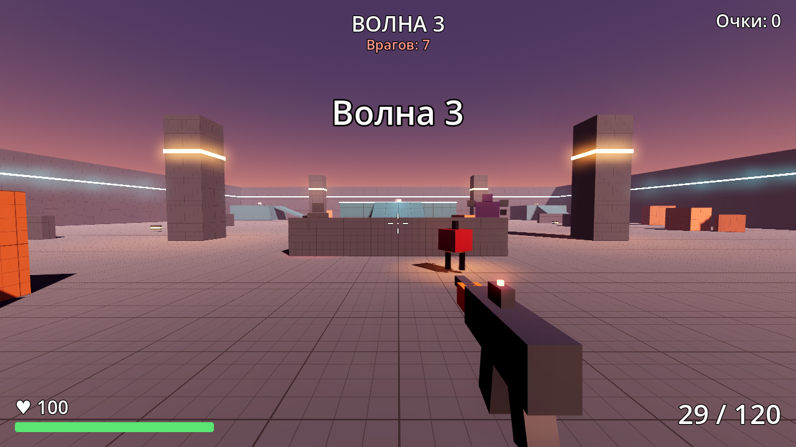

# Робо-Арена

Шутер от первого лица на Godot 4.7: продержись как можно больше волн боевых роботов.

## Как запустить

1. Нужен Godot **4.7** (обычная версия, не .NET) — https://godotengine.org/download
2. В менеджере проектов: **Импорт** → выберите `robo-arena/project.godot`.
3. Нажмите **F5**.

## Управление

| Клавиша | Действие |
|---|---|
| W A S D | движение |
| Shift | бег |
| Пробел | прыжок |
| Мышь | обзор |
| ЛКМ | огонь (автоматический) |
| R | перезарядка |
| Esc / P | пауза |

## Что есть в игре

- **Волны врагов** — с каждой волной роботов больше, они крепче и быстрее. За прохождение волны — бонусные очки.
- **Три типа роботов:**
  - *Стрелок* (красный визор) — держит дистанцию, стреляет плазмой и уходит вбок;
  - *Штурмовик* (оранжевый) — быстрый, бежит в ближний бой;
  - *Громила* (фиолетовый, с 4-й волны) — медленный и бронированный, стреляет веером из трёх зарядов.
- **Автомат** — 30 патронов в магазине, разброс растёт при движении и длинных очередях, отдача, трассеры, попадание в голову ×2.5.
- **Аптечки и патроны** — лежат на арене и появляются снова через 25 секунд, иногда выпадают из роботов.
- Роботы обходят препятствия по навигационной сетке; на арене есть платформы с пандусами, колонны и укрытия.
- Рекорд сохраняется между запусками.

## Структура

| Папка | Что внутри |
|---|---|
| `scenes/main.tscn` | арена, игрок, менеджер волн, интерфейс |
| `scenes/player`, `scripts/player` | игрок и оружие |
| `scenes/enemies`, `scripts/enemies` | роботы и их снаряды |
| `scenes/pickups` | аптечка и патроны |
| `scenes/effects` | искры от попаданий, взрывы |
| `scenes/level` | `Block` — блок уровня, размер задаётся в инспекторе |
| `scenes/ui` | интерфейс, меню, тема оформления |
| `materials`, `sounds`, `textures` | материалы, звуки, текстура сетки |

Параметры (урон, скорость, здоровье) удобно менять в инспекторе: выделите робота в
`scenes/enemies/*.tscn` или оружие в `scenes/player/weapon.tscn`.
